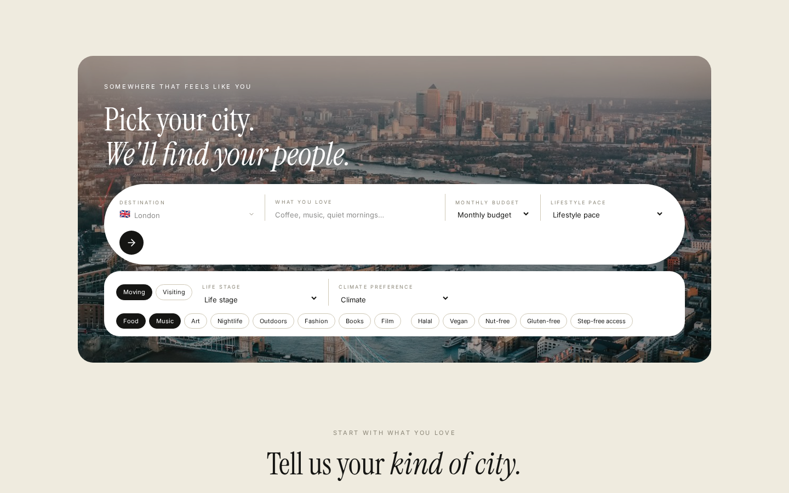
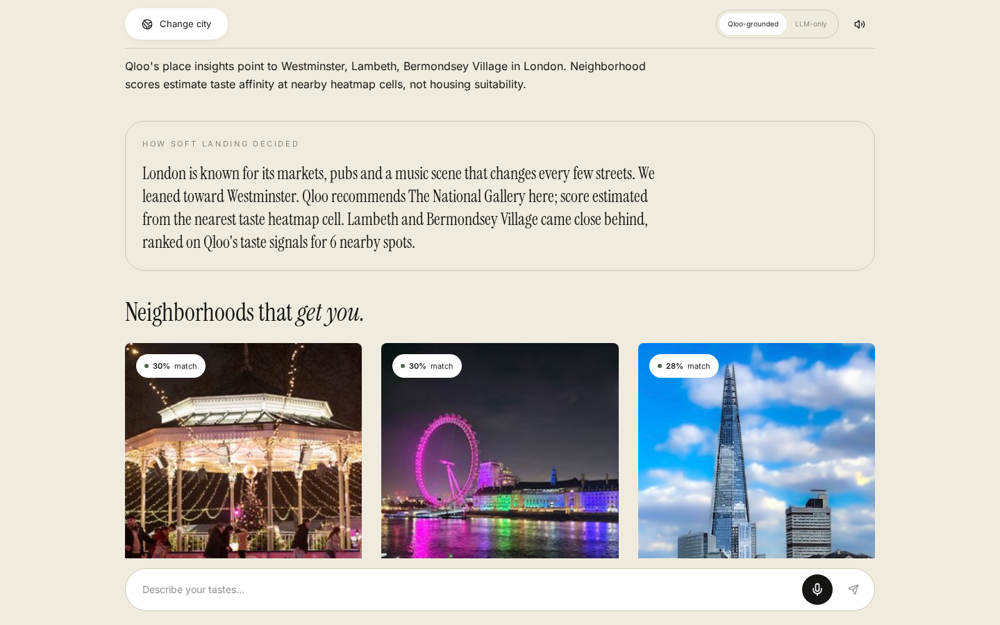
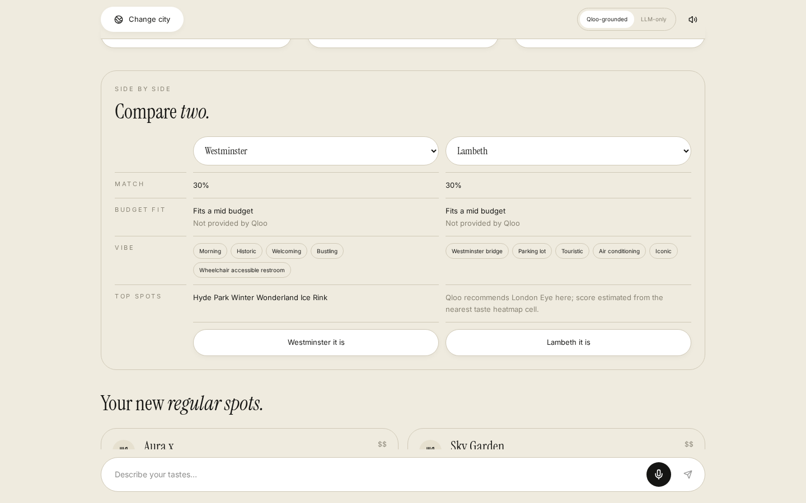
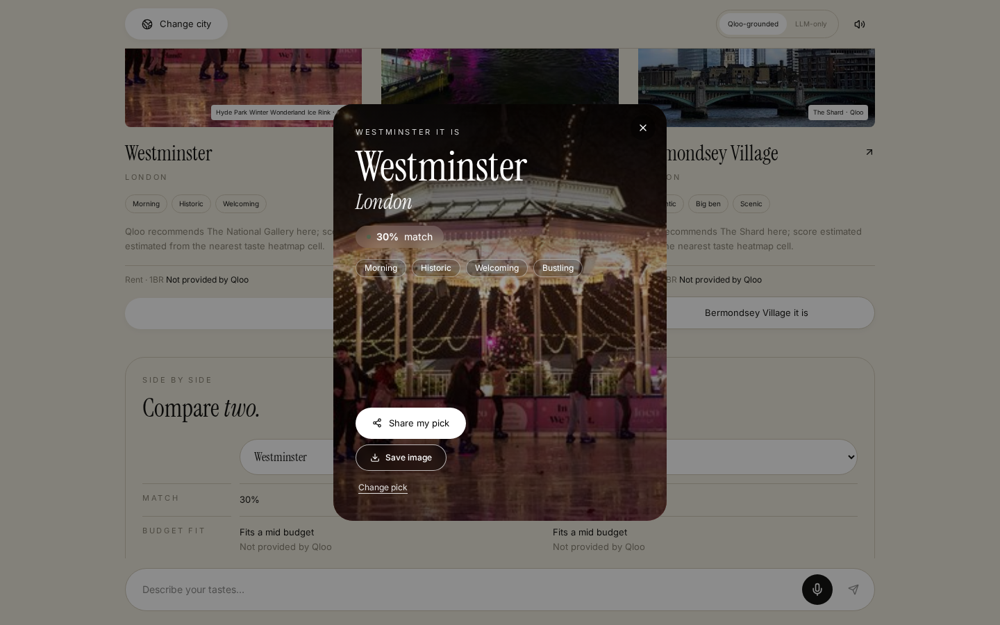

<p align="center"></p>

# Soft Landing

**Move anywhere, feel at home.** Soft Landing is a voice-first AI relocation and trip agent for any city in the world. Pick a destination, say (or type) what you love (music, food, art, nightlife, vibe) and Soft Landing matches you with neighborhoods and places that fit, explains why each one was picked, and builds a personal plan.

**Live demo:** https://softlanding-mauve.vercel.app

**Demo video:** https://vimeo.com/1239110450

Built for the [Qloo Agentic Hackathon](https://qloo.devpost.com).



## How Qloo powers it
- **Live Qloo insights.** Every search makes real, server-side calls to the Qloo Taste AI API: taste lookups for your interests, place insights for the city, and a neighborhood heatmap. The API key never reaches the browser.
- **"Why we picked this."** Every result explains its match. Match scores come from Qloo affinity and heatmap signals, capped at 99%.
- **"How Soft Landing decided" panel.** A plain-language story of what the agent did and why it leaned toward its top neighborhood.
- **Qloo-grounded vs LLM-only toggle.** Run the same search in both modes to compare what Qloo adds (see below).
- If Qloo fails or a city isn't covered, the app says so instead of inventing results.



## Features
- **Neighborhood matches** with match scores, vibe tags, top spots and budget fit
- **Side-by-side comparison** of any two neighborhoods
- **"&lt;Neighborhood&gt; it is" lock-in**: pick your neighborhood and get a shareable card (share link or save as PNG)
- **Your new regular spots**: cafés, bars, venues and places to try
- **Interactive OpenStreetMap map** with pins and "Get Directions"
- **Voice input** (Web Speech API) with a typing fallback
- **Optional read-aloud**: answers are spoken only for voice-started searches or when the read-aloud toggle is on, with a stop button
- **Any city** via a city picker with a tappable dropdown and popularity-ranked autocomplete (type "pa" and Paris comes first)
- **Clear proceed button**: "Find my neighborhoods →" at the end of the form
- **Results open on "Neighborhoods that get you"** first; the 30-day plan sits further down
- **Mobile-friendly form**: no zoom-on-tap or sideways overflow on phones
- **Preferences**: budget, lifestyle pace, life stage, climate, dietary and access needs (used to rank and filter, not sent to Qloo)
- **Moving mode** (first-weeks plan, saved in the browser) and **Visiting mode** (day-by-day trip plan)
- **Real photos** of neighborhoods and places from Wikipedia / Wikimedia Commons, strictly matched to the right place and city, with fallbacks so no card is blank: another Wikipedia photo from the same article, then a curated photo, then a city photo
- **Rent row hidden** when there's no rent figure, instead of showing a placeholder





More: [the map view](docs/02-map.png).

## Qloo-grounded vs LLM-only mode
The toggle at the top of the results switches between:
- **Qloo-grounded** (default): Qloo taste, place and heatmap data drive the ranking; an LLM writes the explanations on top of it.
- **LLM-only**: Google Gemini (`gemini-3.5-flash-lite`) matches your taste to your preferences on its own, so you can compare the two modes side by side.

The LLM is Google Gemini, called server-side with the `GEMINI_API_KEY` secret (read in `src/lib/llm.server.ts`). It is never exposed to the browser.

## Tech stack
- React 19 + Vite + TypeScript, TanStack Start server functions, Tailwind CSS (built with Lovable)
- Supabase (Lovable Cloud) backend
- Qloo Taste AI API (insights, tags, heatmap), called server-side
- Google Gemini (`gemini-3.5-flash-lite`) for the LLM
- Leaflet + OpenStreetMap, Wikipedia / Wikimedia Commons APIs
- Vitest for tests (53 tests)
- Hosted on Vercel

## How to run
Requirements: Node.js 18+ and npm.

```bash
git clone https://github.com/Bamioishim/softlandingapp-aed02219.git
cd softlandingapp-aed02219
npm install
```

Set the environment variables in a local `.env` (and as secrets on your server; never commit real keys):

```bash
QLOO_API_KEY=your_qloo_hackathon_key        # server-side; base URL https://hackathon.api.qloo.com, header X-Api-Key
GEMINI_API_KEY=your_gemini_key              # server-side; powers explanations and LLM-only mode
VITE_SUPABASE_URL=https://<project>.supabase.co
VITE_SUPABASE_PUBLISHABLE_KEY=<supabase publishable/anon key>
VITE_SUPABASE_PROJECT_ID=<project id>
SUPABASE_URL=https://<project>.supabase.co
SUPABASE_PUBLISHABLE_KEY=<supabase publishable/anon key>
```

Then:

```bash
npm run dev     # start the app
npm test        # run the tests
npm run build   # production build
```

Open the local URL shown in the terminal.

## Credits
- Taste data: [Qloo](https://www.qloo.com) Taste AI API
- Photos: [Wikipedia](https://www.wikipedia.org) and [Wikimedia Commons](https://commons.wikimedia.org) contributors, used under their respective free licenses (CC BY / CC BY-SA / public domain); see each file's Commons page for author and license
- Maps: © [OpenStreetMap](https://www.openstreetmap.org/copyright) contributors, via Leaflet
- Fonts: Instrument Serif and Inter (Google Fonts)

## License
MIT. See [LICENSE](LICENSE).
